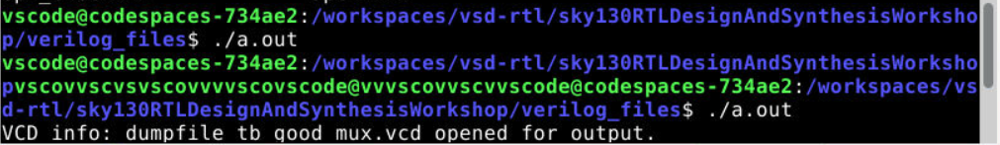
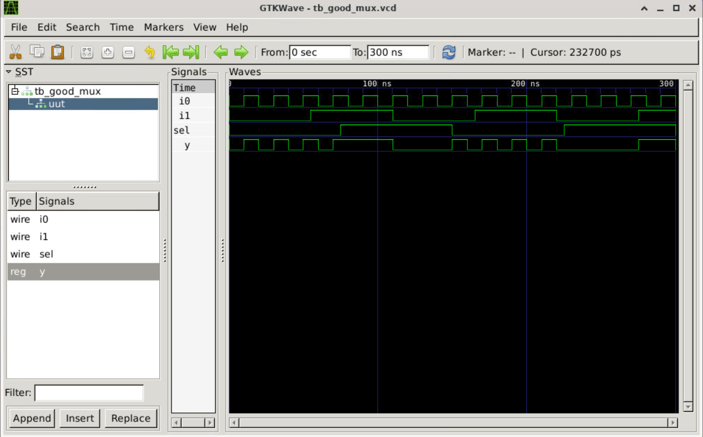
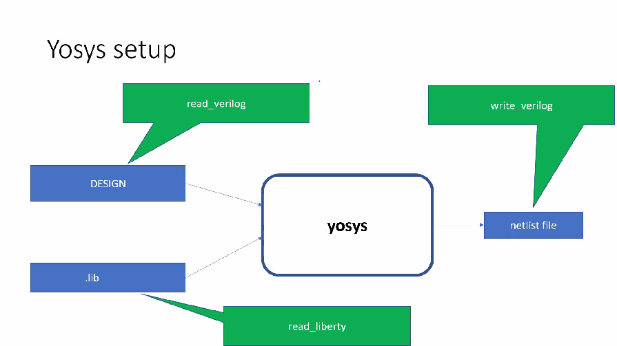
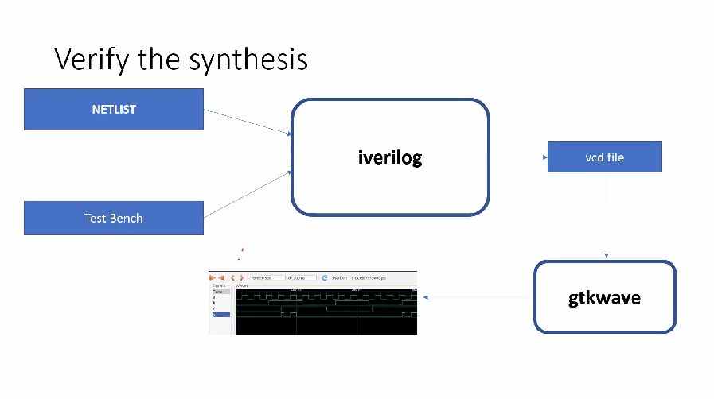
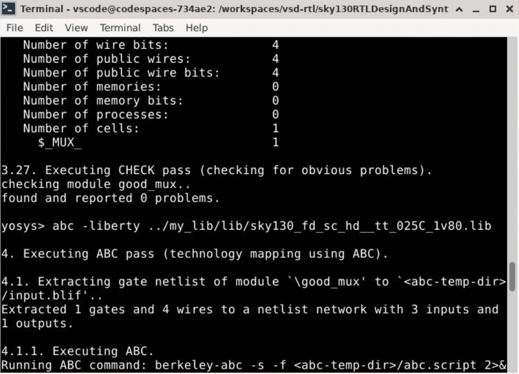
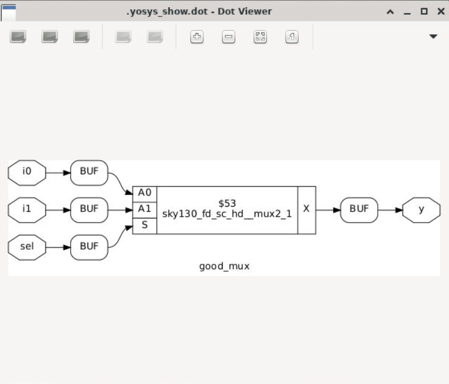

# RTL Design And Synthesis Workshop using Sky130

Day 1 - Introduction to Verilog RTL design and Synthesis

Introduction to open-source simulator iverilog

Video-1 : Introduction to iverilog design test bench

Simulator - RTL design is checked to adherence to the spec by simulating the design.Simulator is the tool used for simulating the design.

#iverilog is the tool used for this course.

Design-Design is the actual Verilog code or set of Verilog codes which has the intended functionality to meet with the required specifications.

Testbench- Testbench is the setup to apply stimulus to the design to check its functionality.

#The design and the testbench setup:


#iverilog based simulation flow


Labs Using iverilog and gtkwave

Video-2 : Lab 1 - Introduction to lab

#File setup

In this Course, the ready to use cloud-based lab is used for RTL Design and Synthesis using open-source tools such as Yosys, Icarus Verilog, and GTKWave. All the tools run inside a GitHub Codespace with noVNC desktop access, which requires no installation.
Once the noVNC desktop terminal is openend, all the workshop files including the library files,verilog files and the standard cell verilog model are present inside the directory named sky130RTLDesignAndSynthesisWorkshop inside the workspaces folder. The below image is the all files going to use in the project.


Video -3 : Lab 2 - Introduction to iverilog and gtkwave - Part 1
Loading the verilog file mux into the simulator (iverilog). 


To load into the simulator,the design name and the testbench name should be given along with the command iverilog.
Once its loaded in the simulator, a.out files will be created.
When executing the a.out file, its going to dump the vcd file (the output of the simulator will be the vcd file).



The vcd file will be loaded for the waveform analysis in the gtkwave and check its functionality.

#Waveform Analysis of Mux


Video -4 : Lab 3 - Introduction to iverilog and gtkwave - Part 2

#File Structure of design and testbench files


Introduction tp Yosys and Logic Synthesis

Video-5 : Introduction to yosys

Synthesizer : Tool used for converting the RTL to netlist. Yosys is used as the synthesizer in this course.

Netlist - The representation of the design in the form of the cells present in the .lib file (standard cell).
```
read_verilog //command to read the design
read_liberty //command to read the .lib file
write_verilog //command to write the netlist
```



To verify the Synthesis



The stimulus should be same as the output observed during the RTL simulation.
The set of Primary inputs/primary outputs will remain same between the RTL design and synthesized netliset and the same testbench can be used.

Video -6 Introduction to Logic Synthesis Part 1
Logic Synthesis

RTL Design - Behavioural representation of the required specification,which will be written in the HDL language.

Instead of RTL Code, if the digital logic circuit(hardware circuit) is needed. How to map these two?
Answer : Synthesis - RTL to code Gate level translation. The design is converted into gates and the connections are made between the gates. The file written out is called netlist.

What is .lib?
Collection of logical modules. Includes basic logic gates like AND,OR,NOT,ETC.,. It may contain different flavors of same gate.

Why do we need different flavours of Gate?
Combinational delay in logic path determines the maximum speed of operation of digital logic circuit.



The clock cycle needs to accomodate the propogation delay of the Clock A and the combinational delay and the setup time of the clock B and that should be the minimum requirement of the clock period.That will decide the maximum frequency.

Video -7 Introduction to Logic Synthesis Part 2

The faster cells in the .lib are sufficient to make T_combination small. 
Why do we need slow cells?



The delay from FF_A to FF_B should be greater than the Hold time. The hold time of the flop is the time after the edge of the clock, the data shouldn't be changed.
#Faster cells are needed to meet the setup and slower cells are needed to meet the hold.

The Capcitance is the load in the digital logic circuit.

Faster cells vs Slower cells

Faster the charging or discharging the capacitance, the lesser will be the propogation delay.

To charge or discharge the capacitance fast , the more current sourcing capability which is wide transistors are needed. The current carrying capability of a transistor is the function of its width.The wider the transistor, the progation delay will be low and more area and power. The narrow the transistor, the propogation delay will be more and less the area and power.

Selection of Cells

The synthesizer need to be guided to select the appropriate flavour of cells that is optimum for the implementation of logic circuit is called Constraints.

The more the usage of the faster cells, its bad interms of power and area and it results in hold time violations. The more the usage of slower cells, may not need the performance need and the circuit will be sluggish.

Labs using Yosys and Sky130 PDKs

Video - 8 Lab 3 Yosys-1 good mux Part-1

Invoke the Yosys


```
read_liberty -lib ../my_lib/lib/sky130_fd_sc_hd__tt_025C_1v80.lib//command to read the library and need to give the path
read_verilog good_mux.v //command to read the design-verilog file,taken example mux
synth -top good_mux //command the module used for synthesis
abc -liberty ../my_lib/lib/sky130_fd_sc_hd__tt_025C_1v80.lib // command to generate the netlist along the path to the lib. abc is a command which converts the RTL file into gates(the library path mentioned along the command is the library, where the gates is present that need to be used).
show // command used to show the graphical logic it has realized in the yosys.
write_verilog -noattr good_mux_netlist.v //command to write the netlist
!vim good_mux_netlist.v
```


Steps for design synthesis.
Inference from synthesis 


Generating the netlist


Graphical synthesis logic realized in Yosys


Writing Netlist


