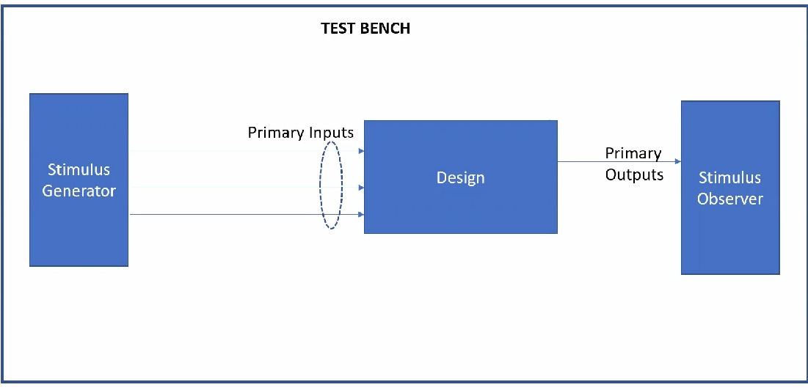

# RTL Design And Synthesis Workshop using Sky130

Day 1 - Introduction to Verilog RTL design and Synthesis

Introduction to open-source simulator iverilog

Video-1 : Introduction to iverilog design test bench

Simulator - RTL design is checked to adherence to the spec by simulating the design.Simulator is the tool used for simulating the design.

#iverilog is the tool used for this course.

Design-Design is the actual Verilog code or set of Verilog codes which has the intended functionality to meet with the required specifications.

Testbench- Testbench is the setup to apply stimulus to the design to check its functionality.

#The design and the testbench setup:

#iverilog based simulation flow

Labs Using iverilog and gtkwave

Video-2 : Lab 1 - Introduction to lab

#File setup

In this Project, the ready to use cloud-based lab is used for RTL Design and Synthesis using open-source tools such as Yosys, Icarus Verilog, and GTKWave. All the tools run inside a GitHub Codespace with noVNC desktop access, which requires no installation.
Once the noVNC desktop terminal is openend, all the workshop files including the library files,verilog files and the standard cell verilog model are present inside the directory named sky130RTLDesignAndSynthesisWorkshop inside the workspaces folder. The below image is the all files going to use in the project.

Video -3 : Lab 2 - Introduction to iverilog and gtkwave - Part 1
